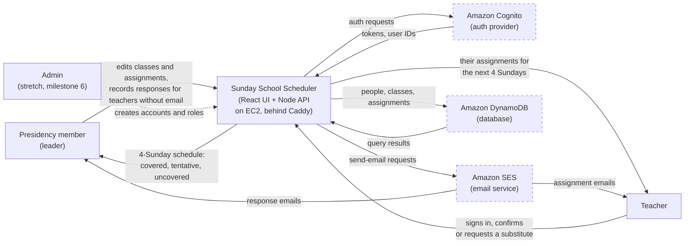
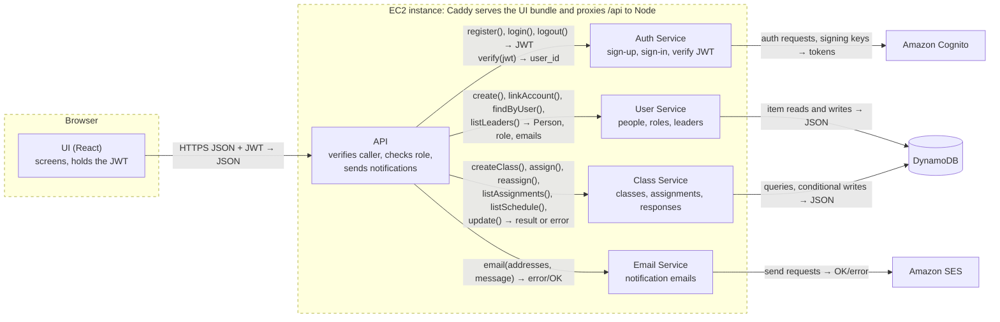
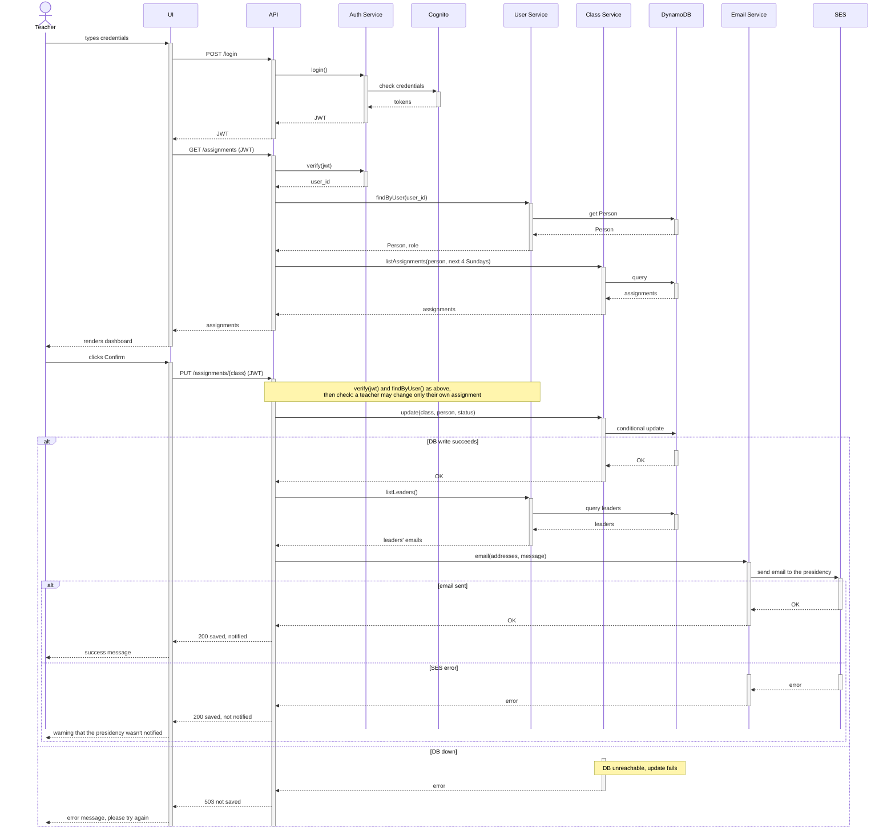
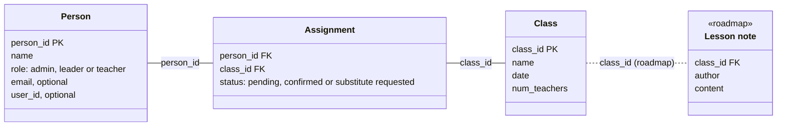

# Sunday School Scheduler — Design Document

| | |
|---|---|
| **Authors** | Hyrum Kammerman |
| **Reviewers** | [who reviewed it — a teammate, the instructor, a design-review partner] |
| **Status** | Draft |
| **Last updated** | 2026-10-20 |
| **Links** | [Proposal](https://docs.google.com/document/d/19jYz_kN3rfb-afqCQExlSvgMchcfi33fQDmuWVzpjow/edit?usp=sharing) · [Repository](https://github.com/Sunday-School-Software/Sunday-School-Scheduler) · [Issue tracker](https://github.com/Sunday-School-Software/Sunday-School-Scheduler/issues) |

## Revision history

| Date | Author | What changed |
|---|---|---|
| 2026-10-16 | Hyrum Kammerman | First draft |
| 2026-10-20 | Hyrum Kammerman | Linked the proposal. Replaced Teacher with Person (teachers and leaders) with an optional email field, so teachers who don't use the app can still be scheduled; leaders record their responses. Defined covered / tentative / uncovered. Decided that an email failure after a successful save only warns the teacher. Matched the notification goals to the proposal's 5 minutes. Added the Cognito and React decisions to §6. Dated the implementation plan and made milestone 4 a stretch goal. Reworded the messaging goal so automatic assignment emails meet it; broadcast messages are part of stretch milestone 4. |
| 2026-10-20 | Hyrum Kammerman | Replaced the whiteboard photos with Mermaid diagrams that match the prose: the context diagram adds DynamoDB and drops the unexplained DNS Provider box, the component diagram adds the Cognito, DynamoDB and SES calls, the sequence diagram shows both failure cases with activation bars, and the data model diagram uses Person with plain lines and the roadmap Lesson note marked «roadmap» on a dashed line. |
| 2026-10-20 | Hyrum Kammerman | Moved the services out of the browser into a Node API on one EC2 instance behind Caddy, as in the proposal, so roles are enforced on the server and only the server can send email. Added the backend decision to §6 and a hosting section to §4, and replaced the open permissions question in §7 with the single-instance risk. Added the calls the core flow needs (`listAssignments`, `findByUser`, `listLeaders`) and how a new account links to its Person. Moved role onto Person, defined a Class as one meeting on one date, and made reassignment email both teachers. Split the leader milestone in two, added hour estimates, deployed from milestone 1, and renumbered the milestones (the stretch goal is now 6). Marked Admin as stretch in the context diagram and added what the app returns to each user. |

---

## 1. Context and scope

Sunday School Scheduler is a web app that helps a Sunday School presidency in The Church of Jesus Christ of Latter-day Saints make sure every Sunday School class on every Sunday has a teacher. Today my ward schedules teachers in a spreadsheet and confirms them by copying and pasting individual messages. That takes real effort and leads to last-minute substitutions. The app gives the presidency a schedule view showing which lessons are covered and gives teachers a one-click way to confirm a lesson or ask for a substitute. It notifies people by email when assignments are made or responded to.

The primary users are presidency members; teachers are secondary users. For this semester the MVP serves one ward. The [project proposal](https://docs.google.com/document/d/19jYz_kN3rfb-afqCQExlSvgMchcfi33fQDmuWVzpjow/edit?usp=sharing) has the full problem statement and the case for building it.

## 2. Goals and non-goals

**Goals**

- A presidency member never has to copy and paste messages to teachers: assigning or reassigning a teacher emails that teacher automatically within 5 minutes.
- A teacher can see their assignments within the next 4 Sundays and confirm a lesson or request a substitute in under 1 minute.
- When a teacher requests a change, the presidency is notified within 5 minutes.
- A presidency member can see who is assigned to every class for the next 4 Sundays in under 1 minute, and spot the uncovered classes at a glance.
- Running cost stays near zero, within free tiers wherever possible.

**Non-goals**

- Other organizations (Relief Society, Elders' Quorum, Primary). The data model is Sunday School–specific.
- More than one ward. There is no multi-tenant separation in the MVP.
- Lesson-plan and content sharing between teachers. It's a nice-to-have, but is not included in this design.
- SMS notifications. Email only for the MVP (see §6).
- Importing members from Member Tools or other Church systems. People join by signing up or by a leader adding them. Until the admin screens exist (stretch milestone 6), leader and admin roles are set by hand.

## 3. System-context diagram

The system is the single box in the middle. Users are on the left; the AWS services it depends on are on the right, drawn with dashed borders. The Admin's dotted arrow is stretch scope (milestone 6).

## 4. Architecture and components

The UI runs in the browser. Everything else runs in one Node process (TypeScript) on an EC2 instance: an API layer that every request goes through, and four services behind it. The browser never holds AWS credentials. Only the instance's IAM role can call DynamoDB and SES, so every read, write and email passes through the API's permission check.

| Component | Responsibility | Talks to | Interface (rough) |
|---|---|---|---|
| UI | Runs in the browser. Handles user interaction: sign-in, the teacher dashboard, the leader schedule, the confirm/substitute actions, and the success, warning and error messages. Holds the JWT for the session. | API | HTTPS JSON requests carrying the JWT, e.g. `POST /login`, `GET /assignments`, `PUT /assignments/{class}` |
| API | The only entry point to the server. On each request it verifies the JWT, looks up the caller's Person and role, rejects anything that role isn't allowed to do, calls the services, and sends notification emails after a successful write. | UI, Auth, User, Class and Email services | HTTP routes in, returning JSON and status codes (200, 403, 503); function calls out |
| Auth Service | Sends sign-up and sign-in requests to Cognito and verifies the JWT on every request against the user pool's signing keys | Cognito | `register()`, `login()`, `logout()` → JWT; `verify(jwt)` → user_id |
| User Service | Manages people and roles: creates Person records, links a new account to its Person, finds the caller's Person, and lists the leaders to notify | DB | `create(name, email?)`, `linkAccount(user_id, email)`, `findByUser(user_id)` → Person with role, `listLeaders()` → leaders' emails |
| Class Service | Creates and edits classes, assigns and reassigns teachers, records responses, and reads the schedule. Uses conditional writes so concurrent edits don't overwrite each other. | DB | `createClass()`, `assign(class, person)`, `reassign(class, from, to)`, `listAssignments(person, dates)`, `listSchedule(dates)`, `update(class, person, status)` → result or error |
| Email Service | Sends notification emails. Only the API calls it, so a signed-in user can't send arbitrary email. | SES | `email(addresses, message)` → error/OK |

The services are the only code that touches Cognito, DynamoDB and SES. All persistent data lives in DynamoDB (§5); credentials and login emails live in Cognito.

**Who can do what.** The API checks each request against the caller's role:

- **Teacher:** sees their own assignments and changes the status of their own assignments only. Anything else returns 403.
- **Leader:** everything a teacher can do, plus creating classes and people, assigning and reassigning teachers, recording responses on anyone's behalf, and viewing the full schedule.
- **Admin:** creates accounts and sets roles (stretch milestone 6; done by hand until then).

### Hosting

The app runs on a single EC2 instance in the same AWS account as Cognito, DynamoDB and SES. Caddy runs on the instance in front of the Node process. It serves the built UI bundle as static files, serves the site over HTTPS on the app's domain with automatically managed certificates, and forwards `/api` requests to Node on the same machine. The instance's IAM role grants access to the app's DynamoDB tables and to sending through SES, so no AWS keys are stored in the code or on the instance.

The instance keeps no data of its own: people, classes and assignments are in DynamoDB and credentials are in Cognito. It can be rebuilt from the repository without migrating anything. The setup and deploy steps belong to CP7 (infrastructure), not this document.

### Core flow, traced end to end

**A teacher confirms an assigned lesson** (the sequence diagram below).

1. The teacher types their credentials into the UI.
2. UI → API: `POST /login`. API → Auth Service: `login()`, which checks the credentials with Cognito and returns a JWT. The UI holds the JWT for the session.
3. UI → API: `GET /assignments` with the JWT. API → Auth Service: `verify(jwt)` → user_id. API → User Service: `findByUser(user_id)` → the teacher's Person and role.
4. API → Class Service: `listAssignments(person, next 4 Sundays)`, which queries the DB. The UI renders the teacher's dashboard.
5. The teacher clicks **Confirm** on an assignment. UI → API: `PUT /assignments/{class}` with status confirmed and the JWT.
6. The API identifies the caller as in step 3 and checks the role: a teacher may change only their own assignment (a leader may change any). Otherwise it returns 403.
7. API → Class Service: `update(class, person, status)`, a conditional write to the DB. The DB returns OK.
8. API → User Service: `listLeaders()` → the presidency's email addresses. API → Email Service: `email(addresses, message)`, which sends through SES and returns OK.
9. The API returns success, and the UI displays a success message to the teacher.

A substitute request is the same flow with a different `status`.

### The failure case

**The database is down when the teacher clicks Confirm** (the "DB down" branch of the sequence diagram).

1. Steps 1–6 proceed as above.
2. Class Service → DB: the conditional update fails. The DB is unreachable.
3. Class Service returns an error, and the API returns 503 to the UI.
4. The UI shows an error message ("Couldn't save your response, please try again"). The API does **not** call the Email Service. Because the update failed, nothing changed and nobody gets an email saying the lesson is confirmed.
5. Recovery: the teacher retries. Saving the same status again leaves the same result, so a retry is safe.

**The opposite partial failure: the DB write succeeds but the email fails** (the "SES error" branch of the sequence diagram).

1. Steps 1–7 proceed as above. The response is saved.
2. API → Email Service: `email(...)` returns an error from SES.
3. The API returns success with a "not notified" flag, and the UI shows a warning ("Your response was saved, but we couldn't notify the presidency. Please let them know directly.") instead of the success message.
4. Recovery is manual: the teacher contacts the presidency, and the saved status already shows on the leader's schedule. The app doesn't retry or record that the email failed (see §7).

## 5. Data model

| Entity | Key fields | Relationships | Owned by | MVP or roadmap |
|---|---|---|---|---|
| Person | person_id, name, role (admin / leader / teacher), email (optional), user_id (optional) | Has many Assignments; may link to one Cognito user account | User Service | MVP |
| Class | class_id, name, date, num_teachers | One meeting of a class on one Sunday; has many Assignments | Class Service | MVP |
| Assignment | person_id, class_id, status (pending / confirmed / substitute requested) | The functional join table between Person and Class | Class Service | MVP |
| Lesson note | class_id, author, content | Belongs to one Class | Class Service | Roadmap |

Credentials and login emails are owned by Cognito, not our DB. Person represents both teachers and presidency members, so one email field serves every notification: emails to the presidency go to the people whose role is leader. Each Person has exactly one role, but assignments attach to a Person rather than a role, so a leader can also be assigned to teach a class.

Not every teacher will use the app, so a Person can exist with no user account and no email. The presidency can still assign that teacher and track their classes. The app doesn't email them, and a leader records their response (confirmed or substitute requested) on their behalf after talking to them directly. When someone signs up, User Service's `linkAccount()` attaches the new account to the Person a leader already created with the same email, or creates a new Person with the teacher role if there isn't one.

A Class is one meeting on one date. Gospel Doctrine on Nov 8 and Gospel Doctrine on Nov 15 are two Class records with the same name, so every assignment belongs to exactly one Sunday.

Assignment is the join between Person and Class. When a leader replaces a teacher, `reassign()` removes the old Assignment and creates a pending one for the new teacher in a single write. The API then emails both people: the new teacher gets the usual assignment email, and the replaced teacher is told they're no longer teaching that class. Someone with no email gets neither, and the leader tells them directly.

Each class on the schedule is shown in one of three states:

- **Covered:** it has `num_teachers` assignments and all of them are confirmed.
- **Tentative:** it has `num_teachers` assignments, but at least one is still pending.
- **Uncovered:** it has fewer than `num_teachers` assignments, or any assignment has a substitute requested.

MVP relationships are solid lines. The roadmap Lesson note is labeled «roadmap» and joined by a dashed line.

## 6. Technology choices and alternatives considered

### Decision: put a Node backend between the UI and AWS

- **Chosen:** A Node API (TypeScript) on one EC2 instance behind Caddy. The UI calls only the API, and only the API calls DynamoDB and SES.
- **Alternative considered:** No backend. The browser gets temporary AWS credentials from a Cognito identity pool and calls DynamoDB and SES directly, with fine-grained IAM policies limiting what each user can touch. This is a common serverless pattern and would leave no server to run.
- **Why the chosen option wins, given our goals:** The roles only mean something if they're enforced somewhere the user can't change. IAM can limit a teacher to items keyed by their own ID, but our rules are about roles and fields: a teacher may change only the status of their own assignment, while a leader may change anyone's assignment and create classes. Those rules are awkward to express in IAM conditions and hard to test. Email is worse: IAM can't limit SES to "notification emails to this ward's leaders", so any signed-in user could send any email from our address. With a backend, every rule is ordinary code in one place that we can unit test, and the browser holds nothing but a JWT. It is also the architecture the proposal planned.
- **What we give up:** There's a server to run, patch and possibly pay for, which works against the near-zero cost goal. The single instance is a single point of failure (§7), and every request takes an extra hop.
- **Evidence:** CP3 spike (`aws-spike`): the same small app was deployed to EC2 in Express/TypeScript and sent email through SES, so the deploy path and the SES call from a server are already proven.
- **What would change our mind:** The instance's cost or upkeep becomes a problem during the pilot. The API could then move to AWS Lambda behind API Gateway with the same routes and permission checks, which keeps the checks on the server.

### Decision: send notifications by email through AWS SES

- **Chosen:** Email through AWS SES.
- **Alternative considered:** SMS through AWS SNS. Text messages are what teachers would read fastest on a Sunday morning.
- **Why the chosen option wins, given our goals:** The notification goals (the presidency and teachers hear about changes within 5 minutes, without anyone messaging teachers one by one) need a channel that works this semester. SES sent email from the app in the spike. SNS SMS did not deliver, and getting SMS to work means extra registration and sandbox steps we can't count on finishing in time. SES also uses the same AWS account and IAM setup as the rest of the stack, and it's effectively free at our volume.
- **Evidence:** CP3 spike (`aws-spike`). The same small app was deployed to EC2 in both Flask and Express/TypeScript and sent through SES and SNS. SES worked; SNS SMS failed.
- **What would change our mind:** Teachers in user interviews say they don't check email quickly enough to hit the 5-minute goal. SMS would then come back as a roadmap item once the SNS registration is done.

### Decision: store data in DynamoDB

- **Chosen:** Amazon DynamoDB (managed, serverless).
- **Alternative considered:** A SQL database (e.g., PostgreSQL), hosted either on a home server or on the EC2 instance.
- **Why the chosen option wins, given our goals:** The main constraint is hosting with personal equipment and almost no money. DynamoDB has no server to patch, back up or keep running, and our volume (one ward, a few dozen people, a few hundred assignments a year) is well within the free tier. The backend already runs on an EC2 instance (§4), so there is a server either way. Keeping the data in DynamoDB keeps that instance stateless: it can be rebuilt or replaced without migrating or backing up any data. Running PostgreSQL on the same instance would put database backups and upgrades on a single developer and tie the data to one machine. A home server adds uptime and security work on top of that. DynamoDB also sits next to Cognito and SES in the same AWS account and permission model.
- **What we give up:** The data model is relational (Assignment joins Person and Class), and SQL handles joins and constraints naturally. With DynamoDB we have to design around our access patterns, mainly "assignments for a teacher" and "assignments for the next 4 Sundays", and enforce the relationships in the services.
- **Evidence:** None yet for DynamoDB itself. The spike confirmed we can provision and use AWS services from this account.
- **What would change our mind:** The access patterns need ad-hoc queries or joins that don't fit DynamoDB's key design, or roadmap features (like lesson notes or multiple wards) make the model much more relational.

### Decision: use Amazon Cognito for sign-in

- **Chosen:** A Cognito user pool, which handles sign-up, sign-in, sessions and account recovery and issues the JWT the UI holds and the API verifies.
- **Alternative considered:** Writing our own auth: hash passwords ourselves, store users in DynamoDB, and issue our own session tokens.
- **Why the chosen option wins, given our goals:** The app stores ward members' names and email addresses, so getting auth wrong is the most damaging mistake we could make, and a solo developer with a 20–25 hour build budget can't review homemade password storage, token expiry and password-reset flows carefully enough. Cognito provides all of that, including email verification and account recovery, which we'd otherwise build and test ourselves. The API checks its tokens against the user pool's public signing keys, so we never store passwords. It sits in the same AWS account as DynamoDB and SES, and at one ward it is well within the free tier.
- **What we give up:** We're locked into Cognito's sign-up and recovery flows and its token format, and debugging Cognito configuration is harder than debugging our own code. Login emails live in Cognito, separate from `Person.email` (§5).
- **Evidence:** None yet; the CP3 spike didn't use Cognito. The proposal budgets about 4 hours for setting up the database and Cognito together.
- **What would change our mind:** Cognito setup goes well past that budget during milestone 1, or its sign-up flow is a barrier for teachers who aren't comfortable with technology (for example, the verification step loses them).

### Decision: build the UI with React and TypeScript

- **Chosen:** React with TypeScript, bundled with Vite.
- **Alternative considered:** Vue, which is comparable for an app this size: a reactive component framework with first-class TypeScript and Vite support.
- **Why the chosen option wins, given our goals:** Neither framework is clearly better for a schedule grid and a few forms, so the deciding factor is how fast we can build. I already have experience with React and TypeScript, and with 20–25 build hours, time spent learning Vue is time not spent on the P0 features. React is also the framework a future contributor is most likely to already know, which matters for an open-source project, and its ecosystem has more ready-made pieces (accessible table and calendar components) to choose from. Using TypeScript on both the UI and the API also lets them share request and response types.
- **What we give up:** Vue's single-file components and built-in state handling would mean somewhat less boilerplate than React.
- **Evidence:** Prior experience with React and TypeScript (see the proposal's technical approach). No prototype was built in either framework.
- **What would change our mind:** The contributors who join the project mostly know Vue rather than React while the codebase is still small enough to switch.

## 7. Risks and open questions

| Risk or question | Why it matters | Owner | How we'll find out, and by when |
|---|---|---|---|
| The single EC2 instance goes down, or has to be rebuilt, during the pilot. | Nobody can sign in or respond until it's back, so classes could go unconfirmed on a Sunday morning. | Hyrum | Keep the instance stateless (§6) and script its setup in CP7 so it can be rebuilt from the repo. Deploy in milestone 1 so it has run for three weeks before the pilot. |
| The DB write succeeds but the email fails. We chose to warn only (§4): no retry and no stored flag. | If the teacher ignores the warning, the presidency never hears about it, which breaks the 5-minute notification goal. | Hyrum | Test the warning by forcing an SES error during milestone 2. If the ward pilot shows missed notifications, add a retry or a "notification pending" flag. |
| SES sandbox: new accounts can only send to verified addresses. | Real teachers wouldn't get email until AWS grants production access. | Hyrum | Request SES production access during milestone 2; it must be approved before the ward pilot. |
| Two people act at once (two leaders assign the same class, or a leader reassigns while the teacher confirms). | Lost updates could show a class as covered when it isn't. | Hyrum | Use conditional writes in DynamoDB; test with two browsers during milestone 4. |
| DynamoDB access patterns for relational data. | A poor key design makes the 4-Sunday schedule view slow or awkward. | Hyrum | Write the access patterns down and prototype the table design during milestone 1. |
| How can contact information be collected ethically? | Church member data has usage policies. | Hyrum | Check the Member Tools data policies; only include people who sign up or agree to be added. Before the ward pilot. |
| Will teachers actually use this rather than texts? | The whole value depends on teachers responding in the app. | Hyrum | Interview 1–2 teachers other than me before milestone 3. |

## 8. Implementation plan

The build window is Weeks 9–13 (Oct 26 – Nov 29), about 20–25 hours for one developer. Milestones 1–4 are the proposal's P0 first deliverable. Milestones 1–5 are estimated at about 22 hours, which leaves a little slack inside the budget. Milestone 6 is P1 scope and is a stretch goal: until it's built, accounts and roles are created by hand in Cognito and DynamoDB.

| Milestone | What works when it's done | Depends on |
|---|---|---|
| 1 · Nov 8 · ~7 h | **Thinnest slice, deployed:** the UI and API run on the EC2 instance behind Caddy on the app's domain. A teacher logs in with Cognito, sees their assignments (seeded by hand in DynamoDB) and confirms one. The API rejects changes to other people's assignments. The status is saved and the UI shows success or the DB-down error. | — |
| 2 · Nov 15 · ~3 h | **Notifications:** confirming or requesting a substitute emails the presidency through SES. The "write succeeded, email failed" case shows its warning. SES production access is requested. | 1 |
| 3 · Nov 18 · ~6 h | **Leader schedule:** a presidency member creates and edits classes, assigns and reassigns teachers, and sees the next 4 Sundays with each class marked covered, tentative or uncovered. Assigning a teacher emails that teacher, and reassigning also emails the teacher who was replaced. | 1, 2 |
| 4 · Nov 22 · ~4 h | **Teachers outside the app, and safe concurrent edits:** a leader adds people with no account or email, assigns them, and records their responses. Signing up links a new account to its existing Person. Two people editing the same class at once can't overwrite each other. | 3 |
| 5 · Sundays Nov 29 and Dec 6 · ~2 h | **Ward pilot:** SES production access is approved and the ward Sunday School uses the app for two Sundays (the proposal's success criterion). | 4 |
| 6 · stretch, Dec 6 if time allows · ~3–4 h | **Admin and broadcast (stretch):** an admin creates accounts and assigns roles; a leader messages all teachers at once. | 2, 3 |

---

## Sign-off

| Reviewer | Role | Date | Approved |
|---|---|---|---|
| [name] | [role] | [date] | ☐ |
