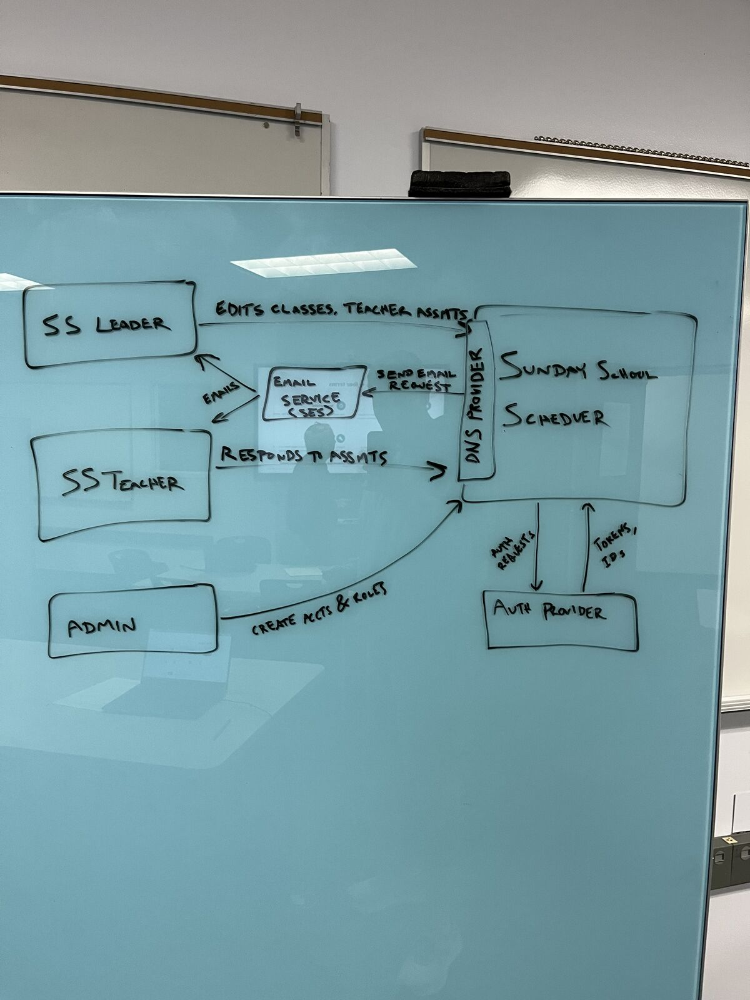
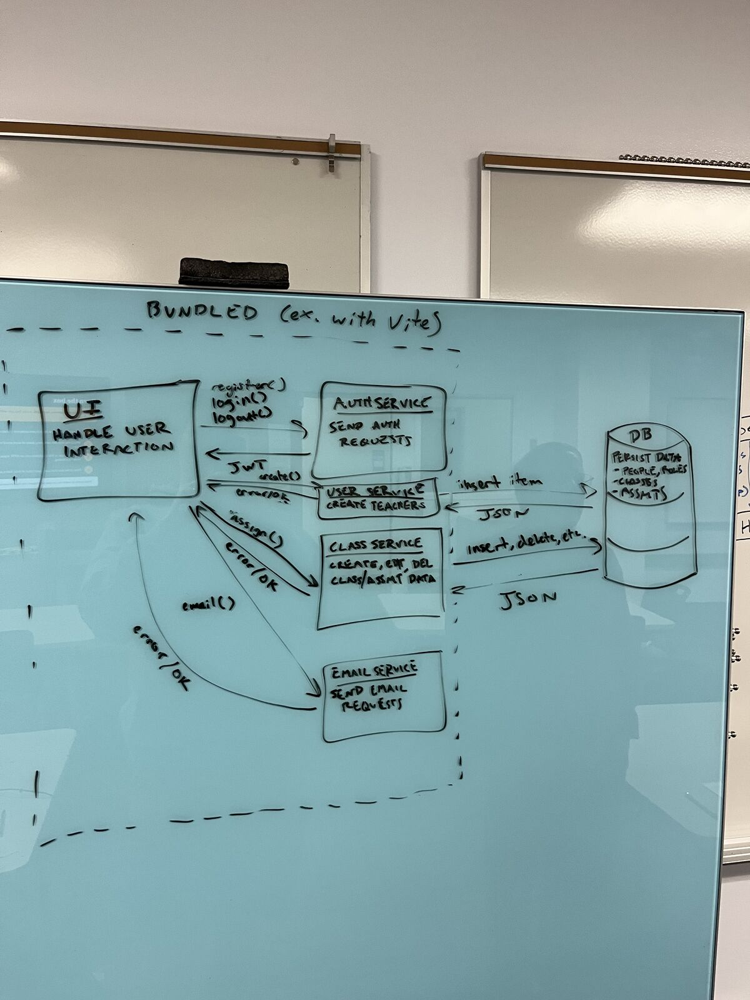
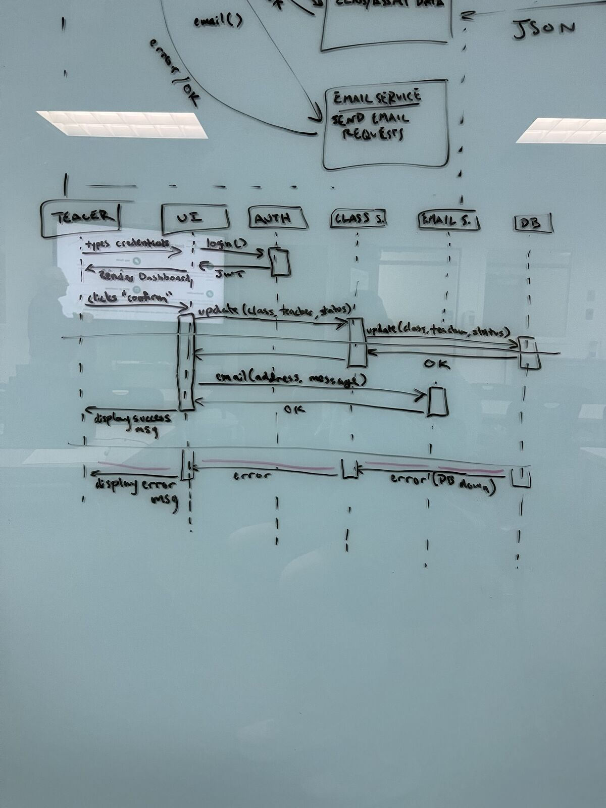
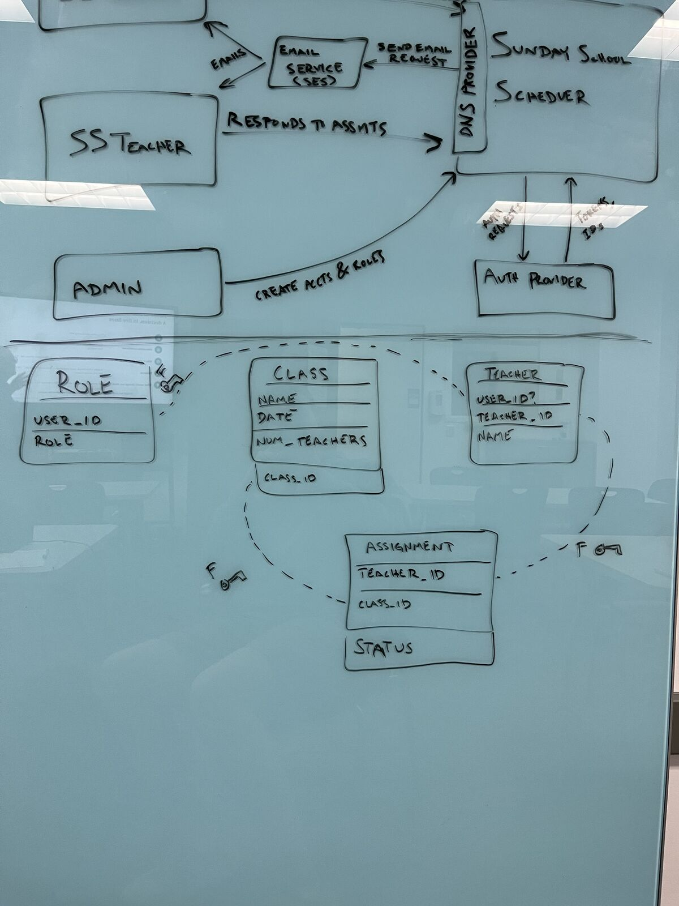

# Sunday School Scheduler — Design Document

| | |
|---|---|
| **Authors** | Hyrum Kammerman |
| **Reviewers** | [who reviewed it — a teammate, the instructor, a design-review partner] |
| **Status** | Draft |
| **Last updated** | 2026-10-20 |
| **Links** | [Proposal](https://docs.google.com/document/d/19jYz_kN3rfb-afqCQExlSvgMchcfi33fQDmuWVzpjow/edit?usp=sharing) · [Repository](https://github.com/Sunday-School-Software/Sunday-School-Scheduler) · [Issue tracker](https://github.com/Sunday-School-Software/Sunday-School-Scheduler/issues) |

## Revision history

| Date | Author | What changed |
|---|---|---|
| 2026-10-16 | Hyrum Kammerman | First draft |
| 2026-10-20 | Hyrum Kammerman | Linked the proposal. Replaced Teacher with Person (teachers and leaders) with an optional email field, so teachers who don't use the app can still be scheduled; leaders record their responses. Defined covered / tentative / uncovered. Decided that an email failure after a successful save only warns the teacher. Matched the notification goals to the proposal's 5 minutes. Added the Cognito and React decisions to §6. Dated the implementation plan and made milestone 4 a stretch goal. Reworded the messaging goal so automatic assignment emails meet it; broadcast messages are part of stretch milestone 4. |

---

## 1. Context and scope

Sunday School Scheduler is a web app that helps a Sunday School presidency in The Church of Jesus Christ of Latter-day Saints make sure every Sunday School class on every Sunday has a teacher. Today my ward schedules teachers in a spreadsheet and confirms them by copying and pasting individual messages. That takes real effort and leads to last-minute substitutions. The app gives the presidency a schedule view showing which lessons are covered and gives teachers a one-click way to confirm a lesson or ask for a substitute. It notifies people by email when assignments are made or responded to.

The primary users are presidency members; teachers are secondary users. For this semester the MVP serves one ward. The [project proposal](https://docs.google.com/document/d/19jYz_kN3rfb-afqCQExlSvgMchcfi33fQDmuWVzpjow/edit?usp=sharing) has the full problem statement and the case for building it.

## 2. Goals and non-goals

**Goals**

- A presidency member never has to copy and paste messages to teachers: assigning or reassigning a teacher emails that teacher automatically within 5 minutes.
- A teacher can see their assignments within the next 4 Sundays and confirm a lesson or request a substitute in under 1 minute.
- When a teacher requests a change, the presidency is notified within 5 minutes.
- A presidency member can see who is assigned to every class for the next 4 Sundays in under 1 minute, and spot the uncovered classes at a glance.
- Running cost stays near zero, within free tiers wherever possible.

**Non-goals**

- Other organizations (Relief Society, Elders' Quorum, Primary). The data model is Sunday School–specific.
- More than one ward. There is no multi-tenant separation in the MVP.
- Lesson-plan and content sharing between teachers. It's a nice-to-have, but is not included in this design.
- SMS notifications. Email only for the MVP (see §6).
- Importing members from Member Tools or other Church systems. People join by signing up or being added by an admin.

## 3. System-context diagram

## 4. Architecture and components

The UI and the four services are built and shipped together as one front-end bundle (built with Vite). The bundle is the dashed boundary in the component diagram. Persistent data lives in the database outside the bundle.

| Component | Responsibility | Talks to | Interface (rough) |
|---|---|---|---|
| UI | Handles user interaction: login, the dashboard and schedule views, the confirm/substitute actions, and the success and error messages | Auth, User, Class and Email services | Function calls into the services; renders their results |
| Auth Service | Sends auth requests to the auth provider and hands the UI a JWT for the session | Cognito | `register()`, `login()`, `logout()` → JWT |
| User Service | Creates people (teachers and leaders) and manages their roles | DB | `create()` → error/OK; reads and writes items in the DB |
| Class Service | Creates, edits and deletes classes and teacher assignments, and records a teacher's response | DB | `assign()`, `update(class, teacher, status)` → error/OK; insert, delete, etc. against the DB |
| Email Service | Sends notification emails | SES | `email(address, message)` → error/OK |
| DB (DynamoDB) | Persists people, roles, classes and assignments | User Service, Class Service | Item inserts, updates and queries; returns JSON |

### Core flow, traced end to end

**A teacher confirms an assigned lesson** (the sequence diagram below).

1. The teacher types their credentials into the UI.
2. UI → Auth Service: `login()`. Auth Service checks the credentials with Cognito and returns a JWT.
3. UI renders the teacher's dashboard: their assignments for the next 4 Sundays.
4. The teacher clicks **Confirm** on an assignment.
5. UI → Class Service: `update(class, teacher, status)`.
6. Class Service → DB: `update(class, teacher, status)`. The DB returns OK.
7. Class Service returns OK to the UI.
8. UI → Email Service: `email(address, message)` to notify the presidency. Email Service sends the email through SES and returns OK.
9. UI displays a success message to the teacher.

A substitute request is the same flow with a different `status`.

### The failure case

**The database is down when the teacher clicks Confirm** (the red section at the bottom of the sequence diagram).

1. Steps 1–5 proceed as above.
2. Class Service → DB: `update(...)` fails. The DB is unreachable.
3. Class Service returns an error to the UI.
4. The UI shows an error message ("Couldn't save your response, please try again") and does **not** call the Email Service. Because the update failed, nothing changed and nobody gets an email saying the lesson is confirmed.
5. Recovery: the teacher retries. Saving the same status again leaves the same result, so a retry is safe.

**The opposite partial failure: the DB write succeeds but the email fails.**

1. Steps 1–7 proceed as above. The response is saved.
2. UI → Email Service: `email(...)` returns an error from SES.
3. The UI shows a warning ("Your response was saved, but we couldn't notify the presidency. Please let them know directly.") instead of the success message.
4. Recovery is manual: the teacher contacts the presidency, and the saved status already shows on the leader's schedule. The app doesn't retry or record that the email failed (see §7).

## 5. Data model

| Entity | Key fields | Relationships | Owned by | MVP or roadmap |
|---|---|---|---|---|
| Role | user_id, role (admin / leader / teacher) | One per user account; links to a Person through user_id | User Service | MVP |
| Person | person_id, user_id (optional), name, email (optional) | Has many Assignments; may link to one user account | User Service | MVP |
| Class | class_id, name, date, num_teachers | Has many Assignments | Class Service | MVP |
| Assignment | person_id, class_id, status (pending / confirmed / substitute requested) | The functional join table between Person and Class | Class Service | MVP |
| Lesson note | class_id, author, content | Belongs to one Class | Class Service | Roadmap |

Credentials and login emails are owned by Cognito, not our DB. Person represents both teachers and presidency members, so one email field serves every notification: emails to the presidency go to the Person records whose user has the leader role. Each user account has exactly one role, but assignments attach to a Person rather than a role, so a leader can also be assigned to teach a class.

Not every teacher will use the app, so a Person can exist with no user account and no email. The presidency can still assign that teacher and track their classes. The app doesn't email them, and a leader records their response (confirmed or substitute requested) on their behalf after talking to them directly.

Assignment is the join between Person and Class. Each class on the schedule is shown in one of three states:

- **Covered:** it has `num_teachers` assignments and all of them are confirmed.
- **Tentative:** it has `num_teachers` assignments, but at least one is still pending.
- **Uncovered:** it has fewer than `num_teachers` assignments, or any assignment has a substitute requested.

## 6. Technology choices and alternatives considered

### Decision: send notifications by email through AWS SES

- **Chosen:** Email through AWS SES.
- **Alternative considered:** SMS through AWS SNS. Text messages are what teachers would read fastest on a Sunday morning.
- **Why the chosen option wins, given our goals:** The notification goals (the presidency and teachers hear about changes within 5 minutes, without anyone messaging teachers one by one) need a channel that works this semester. SES sent email from the app in the spike. SNS SMS did not deliver, and getting SMS to work means extra registration and sandbox steps we can't count on finishing in time. SES also uses the same AWS account and IAM setup as the rest of the stack, and it's effectively free at our volume.
- **Evidence:** CP3 spike (`aws-spike`). The same small app was deployed to EC2 in both Flask and Express/TypeScript and sent through SES and SNS. SES worked; SNS SMS failed.
- **What would change our mind:** Teachers in user interviews say they don't check email quickly enough to hit the 5-minute goal. SMS would then come back as a roadmap item once the SNS registration is done.

### Decision: store data in DynamoDB

- **Chosen:** Amazon DynamoDB (managed, serverless).
- **Alternative considered:** A SQL database (e.g., PostgreSQL), hosted either on a home server or on an EC2 instance.
- **Why the chosen option wins, given our goals:** The main constraint is hosting with personal equipment and almost no money. DynamoDB has no server to patch, back up or keep running, and our volume (one ward, a few dozen people, a few hundred assignments a year) is well within the free tier. If we add a backend (see §7), it will be Node on a single EC2 instance, so we may pay for a server anyway. Keeping the data in DynamoDB still keeps that instance stateless: it can be rebuilt or replaced without migrating or backing up any data. Running PostgreSQL on the same instance would put database backups and upgrades on a single developer and tie the data to one machine. A home server adds uptime and security work on top of that. DynamoDB also sits next to Cognito and SES in the same AWS account and permission model.
- **What we give up:** The data model is relational (Assignment joins Person and Class), and SQL handles joins and constraints naturally. With DynamoDB we have to design around our access patterns, mainly "assignments for a teacher" and "assignments for the next 4 Sundays", and enforce the relationships in the services.
- **Evidence:** None yet for DynamoDB itself. The spike confirmed we can provision and use AWS services from this account.
- **What would change our mind:** The access patterns need ad-hoc queries or joins that don't fit DynamoDB's key design, or roadmap features (like lesson notes or multiple wards) make the model much more relational.

### Decision: use Amazon Cognito for sign-in

- **Chosen:** A Cognito user pool, which handles sign-up, sign-in, sessions and account recovery and issues the JWT the UI holds.
- **Alternative considered:** Writing our own auth: hash passwords ourselves, store users in DynamoDB, and issue our own session tokens.
- **Why the chosen option wins, given our goals:** The app stores ward members' names and email addresses, so getting auth wrong is the most damaging mistake we could make, and a solo developer with a 20–25 hour build budget can't review homemade password storage, token expiry and password-reset flows carefully enough. Cognito provides all of that, including email verification and account recovery, which we'd otherwise build and test ourselves. It sits in the same AWS account as DynamoDB and SES, and its tokens can be used to scope access to those services. At one ward it is well within the free tier.
- **What we give up:** We're locked into Cognito's sign-up and recovery flows and its token format, and debugging Cognito configuration is harder than debugging our own code. Login emails live in Cognito, separate from `Person.email` (§5).
- **Evidence:** None yet; the CP3 spike didn't use Cognito. The proposal budgets about 4 hours for setting up the database and Cognito together.
- **What would change our mind:** Cognito setup goes well past that budget during milestone 1, or its sign-up flow is a barrier for teachers who aren't comfortable with technology (for example, the verification step loses them).

### Decision: build the UI with React and TypeScript

- **Chosen:** React with TypeScript, bundled with Vite.
- **Alternative considered:** Vue, which is comparable for an app this size: a reactive component framework with first-class TypeScript and Vite support.
- **Why the chosen option wins, given our goals:** Neither framework is clearly better for a schedule grid and a few forms, so the deciding factor is how fast we can build. I already have experience with React and TypeScript, and with 20–25 build hours, time spent learning Vue is time not spent on the P0 features. React is also the framework a future contributor is most likely to already know, which matters for an open-source project, and its ecosystem has more ready-made pieces (Cognito/Amplify UI components, accessible table and calendar components) to choose from.
- **What we give up:** Vue's single-file components and built-in state handling would mean somewhat less boilerplate than React.
- **Evidence:** Prior experience with React and TypeScript (see the proposal's technical approach). No prototype was built in either framework.
- **What would change our mind:** The contributors who join the project mostly know Vue rather than React while the codebase is still small enough to switch.

## 7. Risks and open questions

| Risk or question | Why it matters | Owner | How we'll find out, and by when |
|---|---|---|---|
| The boards put the services inside the browser bundle, but who enforces permissions? If the browser talks to DynamoDB and SES directly (with Cognito-issued AWS credentials), any signed-in teacher could edit any assignment unless IAM policies prevent it. | Security. Without a server-side check, the roles mean nothing. | Hyrum | Decide between browser-direct access with fine-grained IAM and a thin backend (e.g., Node running on an EC2 instance or home machine) before milestone 1 is built. Spike the IAM option during CP7. |
| The DB write succeeds but the email fails. We chose to warn only (§4): no retry and no stored flag. | If the teacher ignores the warning, the presidency never hears about it, which breaks the 5-minute notification goal. | Hyrum | Test the warning by forcing an SES error during milestone 2. If the ward pilot shows missed notifications, add a retry or a "notification pending" flag. |
| SES sandbox: new accounts can only send to verified addresses. | Real teachers wouldn't get email until AWS grants production access. | Hyrum | Request SES production access during milestone 2; it must be approved before the ward pilot. |
| Two people act at once (two leaders assign the same class, or a leader reassigns while the teacher confirms). | Lost updates could show a class as covered when it isn't. | Hyrum | Use conditional writes in DynamoDB; test with two browsers during milestone 3. |
| DynamoDB access patterns for relational data. | A poor key design makes the 4-Sunday schedule view slow or awkward. | Hyrum | Write the access patterns down and prototype the table design during milestone 1. |
| How can contact information be collected ethically? | Church member data has usage policies. | Hyrum | Check the Member Tools data policies; only include people who sign up or agree to be added. Before the ward pilot. |
| Will teachers actually use this rather than texts? | The whole value depends on teachers responding in the app. | Hyrum | Interview 1–2 teachers other than me before milestone 3. |

## 8. Implementation plan

The build window is Weeks 9–13 (Oct 26 – Nov 29), about 20–25 hours for one developer. Milestones 1–3 are the proposal's P0 first deliverable. Milestone 4 is P1 scope and is a stretch goal: until it's built, accounts and roles are created by hand in Cognito and DynamoDB.

| Milestone | What works when it's done | Depends on |
|---|---|---|
| 1 · Nov 8 | **Thinnest slice:** a teacher logs in with Cognito, sees their assignments (seeded by hand in DynamoDB) and confirms one. The status is saved and the UI shows success or the DB-down error. | — |
| 2 · Nov 15 | **Notifications:** confirming or requesting a substitute emails the presidency through SES. The "write succeeded, email failed" case shows its warning. | 1 |
| 3 · Nov 22 | **Leader schedule:** a presidency member creates and edits classes, assigns teachers (including ones with no account or email), records responses for teachers who don't use the app, and sees the next 4 Sundays with each class marked covered, tentative or uncovered. Assigning a teacher emails that teacher through SES. Concurrent edits are safe. | 1, 2 |
| 5 · Sundays Nov 29 and Dec 6 | **Ward pilot:** deployed on the app's domain with SES production access and used by the ward Sunday School for two Sundays (the proposal's success criterion). | 3 |
| 4 · stretch, Dec 6 if time allows | **Admin and broadcast (stretch):** an admin creates accounts and assigns roles; a leader messages all teachers at once. | 2, 3 |

---

## Sign-off

| Reviewer | Role | Date | Approved |
|---|---|---|---|
| [name] | [role] | [date] | ☐ |
