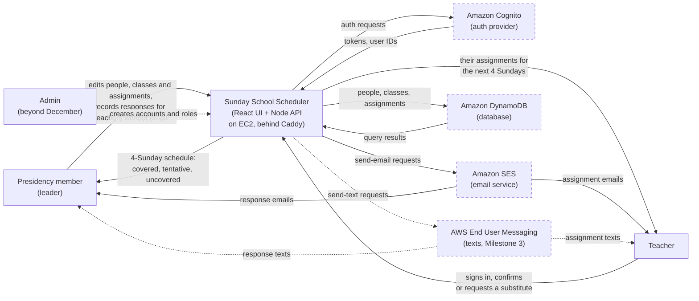
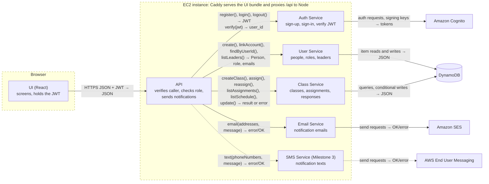
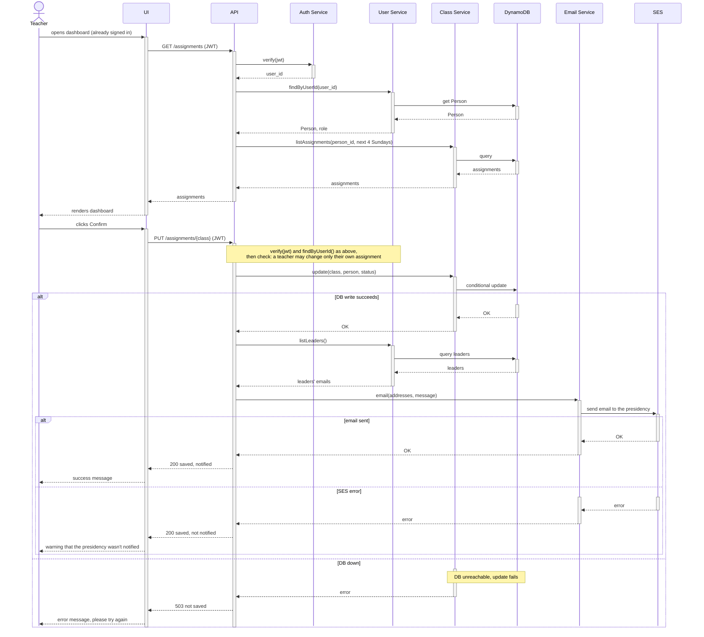
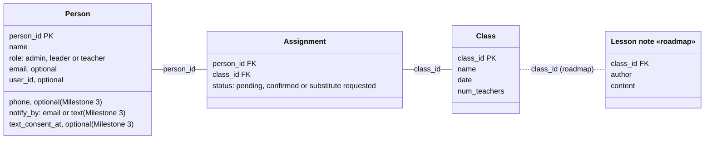

# Sunday School Scheduler — Design Document

| | |
|---|---|
| **Authors** | Hyrum Kammerman |
| **Reviewers** | [who reviewed it — a teammate, the instructor, a design-review partner] |
| **Status** | In review |
| **Last updated** | 2026-11-18 |
| **Links** | [Proposal](https://docs.google.com/document/d/19jYz_kN3rfb-afqCQExlSvgMchcfi33fQDmuWVzpjow/edit?usp=sharing) · [Repository](https://github.com/Sunday-School-Software/Sunday-School-Scheduler) · [Issue tracker](https://github.com/Sunday-School-Software/Sunday-School-Scheduler/issues) |

## Revision history

Details for each revision are in the commit messages (`git log docs/design.md`).

| Date | Author | What changed |
|---|---|---|
| 2026-10-16 | Hyrum Kammerman | First draft |
| 2026-10-20 | Hyrum Kammerman | Revised after draft review; Mermaid diagrams |
| 2026-10-20 | Hyrum Kammerman | Moved the services to a Node backend on EC2; trimmed to length |
| 2026-10-21 | Hyrum Kammerman | Trimmed a bit more and completed final proofread before submission. |
| 2026-11-06 | Hyrum Kammerman | Matched the milestones to the repo's GitHub milestones; admin and broadcast moved beyond December |
| 2026-11-09 | Hyrum Kammerman | Linked the DynamoDB key design ([data-model.md](data-model.md)) from §5, §6 and §7 |
| 2026-11-16 | Hyrum Kammerman | Renamed `findByUser()` to `findByUserId()` to match the code |
| 2026-11-16 | Hyrum Kammerman | §4: the UI follows the Model-View-Presenter pattern |
| 2026-11-16 | Hyrum Kammerman | §4: `listAssignments()` takes a `person_id`, to match the code |
| 2026-11-16 | Hyrum Kammerman | §4: the API row lists every status code the routes return (400, 401 and 503 were missing) |
| 2026-11-18 | Hyrum Kammerman | Texts through AWS End User Messaging in a new Milestone 3, after the MVP: each person picks email or text (§2–§8) |
| 2026-11-18 | Hyrum Kammerman | §4: Terraform creates the server, and shell access goes through Session Manager instead of SSH |

---

## 1. Context and scope

Sunday School Scheduler is a web app that helps a Sunday School presidency in The Church of Jesus Christ of Latter-day Saints make sure every class on every Sunday has a teacher. Today my ward schedules teachers in a spreadsheet and confirms them by copying and pasting individual messages. The app shows the presidency which lessons are covered, gives teachers a frictionless way to confirm or ask for a substitute, and emails people when assignments are made or answered. After the MVP, people can choose to get those notifications by text instead.

## 2. Goals and non-goals

**Goals**

- A presidency member never has to copy and paste messages to teachers: assigning or reassigning a teacher emails that teacher automatically within 5 minutes.
- A teacher can see their assignments within the next 4 Sundays and confirm a lesson or request a substitute in under 1 minute.
- When a teacher requests a change, the presidency is notified within 5 minutes.
- A presidency member can see who is assigned to every class for the next 4 Sundays in under 1 minute, and spot the uncovered classes at a glance.
- Running cost stays near zero, within free tiers wherever possible.

**Non-goals**

- Other organizations (Relief Society, Elders' Quorum, Primary). The data model is Sunday School–specific.
- More than one ward. There is no multi-tenant separation in the MVP.
- Lesson-plan and content sharing between teachers.
- SMS in the MVP. Milestone 2 is email only; texts come in Milestone 3, after the pilot (see §6).
- Importing members from Member Tools or other Church systems. People sign up, and leader roles are added by hand until admin functionality is implemented.

## 3. System-context diagram

## 4. Architecture and components

The UI runs in the browser. Everything else is one Node (TypeScript) process on an EC2 instance: an API that every request passes through, and the services behind it (four in the MVP, plus the SMS Service in Milestone 3). The browser never holds AWS credentials; only the instance's IAM role can call DynamoDB, SES and End User Messaging.

| Component | Responsibility | Talks to | Interface (rough) |
|---|---|---|---|
| UI | Sign-in, teacher dashboard, leader schedule, teacher actions, and messages. | API | HTTPS JSON with the JWT, e.g. `POST /login`, `GET /assignments`, `PUT /assignments/{class}` |
| API | Verifies caller, checks their role, calls services, and sends notifications by each person's chosen channel. | UI and the services | HTTP routes returning JSON and status codes (200, 201, 400, 401, 403, 409, 429, 500, 503) |
| Auth Service | Signs users up and in through Cognito and verifies JWTs | Cognito | `register()`, `verifyEmail()`, `resendCode()`, `login()`, `logout()` → JWT; `verify(jwt)` → user_id; `profile(jwt)` → email and name |
| User Service | Creates people, links and finds accounts and roles, and stores how each person wants to be notified | DB | `create(name, email?)`, `linkAccount(user_id, email, name)`, `findByUserId(user_id)` → Person, `listLeaders()` → leaders' contact details; Milestone 3: `setNotifyBy(person, channel, phone?)` |
| Class Service | Classes, assignments and responses | DB | `createClass()`, `assign(class, person)`, `reassign(class, from, to)`, `listAssignments(person_id, dates)`, `listSchedule(dates)`, `update(class, person, status)` |
| Email Service | Sends notification emails. | SES | `email(addresses, message)` → OK/error |
| SMS Service (Milestone 3) | Sends notification texts from the app's toll-free number. | End User Messaging | `text(phoneNumbers, message)` → OK/error |

**Inside the UI.** The UI follows the Model-View-Presenter pattern. React components hold only view logic, presenters call the API through services and tell the components what to show, and one `ServerFacade` makes every API call. The [setup guide](setup.md#how-the-ui-is-organized) describes the folders.

**Who can do what.** A teacher sees and responds to only their own assignments; anything else returns 403. Only a person can switch their own notifications to text, because carriers require each person's own consent; a leader can't do it for them. A leader can also create classes and people, assign and reassign teachers, record responses for anyone, and see the full schedule. An admin manages accounts and roles (beyond December; see §8).

### Hosting

One EC2 instance, in the same AWS account as Cognito, DynamoDB and SES, runs Caddy in front of the Node process. Caddy serves the built UI bundle, provides HTTPS on the app's domain with automatic certificates, and forwards `/api` requests to Node. The instance's IAM role grants access to the app's tables, to SES, and (from Milestone 3) to sending texts from the app's number, so no AWS keys live in the code. The instance holds no data, so it can be rebuilt from the repository. A Terraform config in `infra/` creates the instance, its role, its security group and its Elastic IP, and keeps its state in S3 so any maintainer can rebuild it; the [setup guide](setup.md#create-the-server) explains how. Only ports 80 and 443 are open. A maintainer gets a shell through AWS Systems Manager Session Manager, so there is no SSH port or key to protect, and besides the app's table (and SES and texts, once notifications are built), the role has only the few permissions Session Manager needs.

### Core flow, traced end to end

**A teacher confirms an assigned lesson.**

1. The signed-in teacher opens the dashboard.
2. UI → API `GET /assignments`. The API identifies the caller with `verify(jwt)` → user_id and `findByUserId(user_id)` → Person and role.
3. API → Class Service `listAssignments(person_id, next 4 Sundays)`. The UI renders the dashboard.
4. The teacher clicks **Confirm**. UI → API `PUT /assignments/{class}`. The API identifies the caller again and checks that the assignment is theirs (or that they're a leader).
5. API → Class Service `update(class, person, status)`, a conditional write that returns OK.
6. API → User Service `listLeaders()`, then Email Service `email(addresses, message)` through SES. From Milestone 3, leaders who chose text get `text(phoneNumbers, message)` from the SMS Service instead.
7. The API returns success and the UI shows a success message. If SES (or, from Milestone 3, End User Messaging) fails after the save, the API still returns 200 and the UI warns that the presidency wasn't notified.

A substitute request is the same flow with a different `status`.

### The failure case

**The database is down when the teacher clicks Confirm.** The conditional write fails, Class Service returns an error, and the API returns 503 without calling the Email Service. The UI says "Couldn't save your response, please try again." Nothing changed and nobody was emailed, and saving the same status again is safe, so recovery is simply retrying.

## 5. Data model

| Entity | Key fields | Relationships | Owned by | MVP or roadmap |
|---|---|---|---|---|
| Person | person_id, name, role (admin / leader / teacher), email (optional), user_id (optional); Milestone 3: phone (optional), notify_by (email / text), text_consent_at (optional) | Has many Assignments; may link to one Cognito account | User Service | MVP |
| Class | class_id, name, date, num_teachers | One meeting of a class on one Sunday; has many Assignments | Class Service | MVP |
| Assignment | person_id, class_id, status (pending / confirmed / substitute requested) | Joins Person and Class | Class Service | MVP |
| Lesson note | class_id, author, content | Belongs to one Class | Class Service | Roadmap |

Cognito owns credentials and login emails. Person covers teachers and leaders, so presidency emails go to people whose role is leader, and a leader can still be assigned to teach. A Person can have no account and no email: leaders still assign them and record their responses after talking to them. When someone signs up, `linkAccount()` attaches the account to the Person with the same email, or creates a new teacher.

From Milestone 3, a Person has a `notify_by` channel, email by default. A signed-in person can switch to text by entering a phone number and agreeing to receive texts; `text_consent_at` records when they agreed, as carriers require. Someone who chose text gets texts only, not emails. Replying STOP turns texts off at the carrier, and the app then sends them email again if it has an address.

On the schedule, a class is **covered** when it has `num_teachers` assignments that are all confirmed, **tentative** when it has `num_teachers` assignments and at least one is pending, and **uncovered** otherwise (too few assignments, or a substitute requested).

All three entities live in one DynamoDB table. [data-model.md](data-model.md) gives its keys and indexes and the query behind every access pattern. To keep each screen to one query, an Assignment also stores copies of its class's name and date and its person's name; whatever changes the original updates the copies too.

## 6. Technology choices and alternatives considered

### Decision: put a Node backend between the UI and AWS

- **Chosen:** A Node (TypeScript) API on one EC2 instance behind Caddy. Only the API calls DynamoDB and SES.
- **Alternative considered:** No backend. The browser gets temporary AWS credentials from a Cognito identity pool and calls DynamoDB and SES directly, limited by fine-grained IAM policies.
- **Why the chosen option wins, given our goals:** Our rules are about roles and fields (a teacher may change only the status of their own assignment; a leader may change any), which are awkward to express and test as IAM conditions. IAM also can't limit SES to notification emails, so any signed-in user could send any email from our address. A backend keeps every rule in testable code, and it's what the proposal planned. The cost is a server to run, patch and pay for, and a single point of failure (§7).
- **Evidence:** CP3 spike (`aws-spike`): an Express/TypeScript app deployed to EC2 sent email through SES.
- **What would change our mind:** The instance's cost or upkeep becomes a problem. The same routes could move to Lambda behind API Gateway, keeping the checks on the server.

### Decision: send notifications by email through AWS SES

- **Chosen:** Email through SES.
- **Alternative considered:** SMS through AWS SNS, which teachers would read fastest on a Sunday morning.
- **Why the chosen option wins, given our goals:** The 5-minute notification goals need a channel that works this semester. SMS needs registration steps we can't count on finishing in time. SES shares the stack's AWS account and is effectively free at our volume.
- **Evidence:** CP3 spike (`aws-spike`): SES delivered; SNS SMS did not.
- **What would change our mind:** Teachers say they don't check email fast enough to meet the 5-minute goal. That hasn't happened: in the Milestone 1 teacher test ([#65](https://github.com/Sunday-School-Software/Sunday-School-Scheduler/issues/65)), the teacher preferred the app to replying to a text. Email stays the MVP's only channel; texts are added after it for a different reason (next decision).

### Decision: add texts through AWS End User Messaging after the MVP

- **Chosen:** In Milestone 3, each person chooses email or text. Texts go through AWS End User Messaging from a registered US toll-free number.
- **Alternatives considered:** Twilio, at about the same price. Keeping email only.
- **Why the chosen option wins, given our goals:** The project has more hours after the MVP than planned, and texts reach people the way the ward already messages each other on a Sunday morning. End User Messaging shares the AWS account, IAM role and bill with SES and DynamoDB, so there's no second vendor or credentials to keep on the instance. A toll-free number is $2 a month, and texts cost a few cents each, a few dollars a month at our volume. Letting each person pick one channel avoids sending everyone two copies, at the cost of a setting to build and a channel that can fail on its own.
- **Evidence:** None yet. In the CP3 spike (`aws-spike`), SNS SMS did not deliver. US carriers now require a registered number, which can take up to 15 business days to approve, so the registration is submitted before any code is written.
- **What would change our mind:** The registration is denied, or isn't approved by Dec 10. Then everyone stays on email and texts go back on the roadmap.

### Decision: store data in DynamoDB

- **Chosen:** Amazon DynamoDB.
- **Alternative considered:** PostgreSQL on the EC2 instance.
- **Why the chosen option wins, given our goals:** DynamoDB has no database to back up or upgrade, it keeps the EC2 instance stateless and rebuildable, and our volume (a few dozen people, a few hundred assignments a year) fits the free tier. PostgreSQL would tie the data to one machine and put backups on a solo developer. The cost is that our model is relational: instead of SQL joins, we design keys around our access patterns ("a teacher's assignments", "the next 4 Sundays") and enforce relationships in the services.
- **Evidence:** The spike confirmed AWS access from this account. The key design in [data-model.md](data-model.md) serves every Milestone 1 and 2 access pattern with a Query or a single-item read or write, without a table scan; tables built from it come in Milestone 1.
- **What would change our mind:** The access patterns need joins or ad-hoc queries that don't fit the key design, or roadmap features make the model much more relational.

### Decision: use Amazon Cognito for sign-in

- **Chosen:** A Cognito user pool for sign-up, sign-in and account recovery. The API verifies its JWTs.
- **Alternative considered:** Our own auth: hashed passwords in DynamoDB and our own session tokens.
- **Why the chosen option wins, given our goals:** The app stores ward members' contact details, so auth mistakes are the costliest kind, and a solo developer with 20–25 hours can't carefully build password storage, token expiry and reset flows. Cognito provides them within the free tier. The cost is lock-in to its flows and harder-to-debug configuration.
- **Evidence:** None yet. The proposal budgets about 4 hours for database and Cognito setup.
- **What would change our mind:** Setup runs well past that budget in Milestone 1, or the verification step loses teachers who aren't comfortable with technology.

## 7. Risks and open questions

| Risk or question | Why it matters | Owner | How we'll find out, and by when |
|---|---|---|---|
| The single EC2 instance goes down during the pilot. | Nobody can sign in or respond on a Sunday morning. | Hyrum | Script the setup as part of deployment so the instance can be rebuilt; deploy by Nov 22, right after the Nov 18 demo, so the app runs on EC2 for a week before the Nov 29 pilot. |
| SES sandbox only sends to verified addresses. | Real teachers get no email until AWS grants production access. | Hyrum | Request production access by Nov 18 (it needs no code), so there is time to resubmit if it is denied before the Nov 29 pilot. |
| Two people edit the same class at once. | A lost update could show a class as covered when it isn't. | Hyrum | Teachers' own responses use conditional writes in Milestone 1. Safe leader edits to classes and assignments are on the roadmap; the pilot has one leader editing, so watch for lost updates during the pilot. |
| DynamoDB keys for relational data. | A poor key design makes the 4-Sunday view slow or awkward. | Hyrum | Write down the access patterns ([data-model.md](data-model.md)) and create the tables in Milestone 1, by Nov 18. |
| Collecting contact information ethically. | Church member data has usage policies, and phone numbers (Milestone 3) are more personal than email. | Hyrum | Check Member Tools policies and include only people who agree, before the pilot. Only a person can add their own phone number. |
| Toll-free registration isn't approved in time. | Approval can take up to 15 business days, so Milestone 3 can't send a text until it comes through. | Hyrum | Publish the privacy policy and terms pages the registration requires and submit it by Nov 20. If it's denied, fix what it names and resubmit. If it isn't approved by Dec 10, ship Milestone 3 with texts turned off. |
| A person who chose text stops getting messages. | A failed or blocked text means they aren't notified, since they get no email. | Hyrum | Treat a failed text like a failed email (§4 step 7), and test it. After STOP, fall back to email if there's an address. |
| Will teachers use this rather than texts? | The value depends on teachers responding in the app. | Hyrum | Interview 1–2 other teachers by Nov 18. |

## 8. Implementation plan

The live plan is the repo's [milestones page](https://github.com/Sunday-School-Software/Sunday-School-Scheduler/milestones). If this table and the milestones page disagree, the milestones page is right.

The build window runs from Oct 26 to the second pilot Sunday, Dec 6. The proposal budgeted 20–25 hours. Milestone 1 is now estimated at 17.5–19 h and Milestone 2 at about 14 h plus deployment, which isn't sized yet, so the plan runs at least 6.5 h over budget. I'll cover the overrun with my own time (see the [Milestone 1 capacity check](https://github.com/Sunday-School-Software/Sunday-School-Scheduler/milestone/2)). Milestone 2 is the squeeze: everything the pilot needs must be live by Nov 28, ten days after the demo and over Thanksgiving week. Milestones 0–2 are the proposal's P0 deliverable; admin and broadcast are a P1 goal for after December. Milestone 3 (texts) was added on Nov 18, after the project gained hours; it comes after the pilot, so it can't delay the MVP.

| Milestone | What works when it's done | Depends on |
|---|---|---|
| Milestone 0: Walking Skeleton · no date · not estimated | **Local setup:** the code needed to test, lint and run the project locally (the API and UI scaffolds, the test setup and the setup guide). Epic: [Walking Skeleton](https://github.com/Sunday-School-Software/Sunday-School-Scheduler/issues/22). | — |
| Milestone 1: Thinnest Slice · Nov 18 · ~17.5–19 h | **Nov 18 demo:** a teacher logs in, sees their hand-seeded assignments for the next 4 Sundays, confirms one, and sees it marked confirmed. It runs locally against the real Cognito pool and DynamoDB tables. The API rejects changes to others' assignments, and the UI shows the DB-down error. Epics: [Data in DynamoDB](https://github.com/Sunday-School-Software/Sunday-School-Scheduler/issues/27), [Sign-in with Cognito](https://github.com/Sunday-School-Software/Sunday-School-Scheduler/issues/28), [Teacher confirms a lesson](https://github.com/Sunday-School-Software/Sunday-School-Scheduler/issues/29). | Milestone 0 |
| Milestone 2: MVP Complete · Dec 2 · ~14 h + deployment | **MVP:** the app is deployed on EC2 behind Caddy. Leaders build the 4-Sunday schedule and get an email for every teacher response (the teacher sees a warning if the email fails). Teachers without accounts are covered, SES production access is approved, and the ward runs the pilot starting Nov 29 (the proposal's success criterion). Epics: [Deploy to EC2 behind Caddy](https://github.com/Sunday-School-Software/Sunday-School-Scheduler/issues/30), [Leaders hear about every response](https://github.com/Sunday-School-Software/Sunday-School-Scheduler/issues/47), [Leaders build the schedule](https://github.com/Sunday-School-Software/Sunday-School-Scheduler/issues/48), [Teachers outside the app](https://github.com/Sunday-School-Software/Sunday-School-Scheduler/issues/49), [Ward pilot](https://github.com/Sunday-School-Software/Sunday-School-Scheduler/issues/50). | Milestone 1 |
| Milestone 3: Notifications by text · Dec 10 · ~10–15 h | **Texts:** a signed-in person can choose to get notifications by text instead of email, after agreeing to receive texts. Leaders who chose text get a text for every teacher response, and teachers who chose text get one when they're assigned. The app's toll-free number is registered. | Milestone 2, and an approved toll-free registration |
| Beyond December · ~3–4 h | **Admin and broadcast:** an admin creates accounts and sets roles; a leader messages all teachers at once. Safe concurrent edits for leaders are also deferred; see §7. | Milestone 2 |

---

## Sign-off

| Reviewer | Role | Date | Approved |
|---|---|---|---|
| [name] | [role] | [date] | ☐ |
