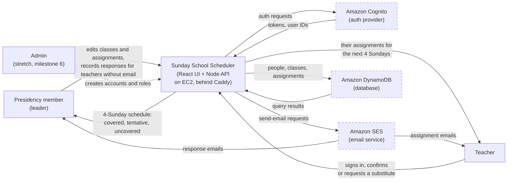
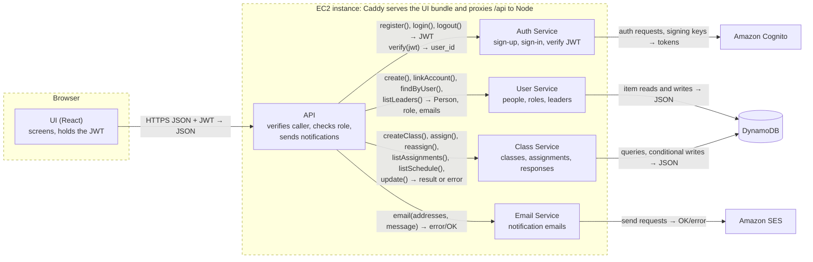
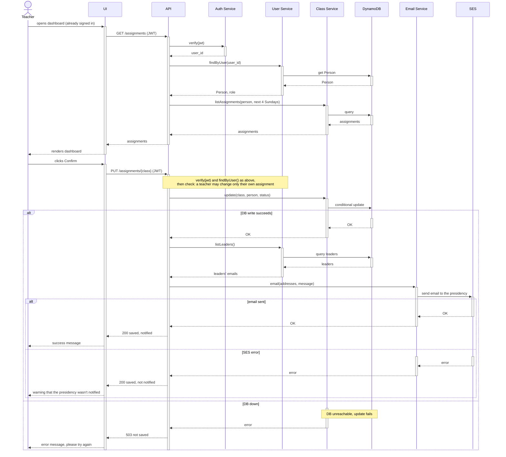
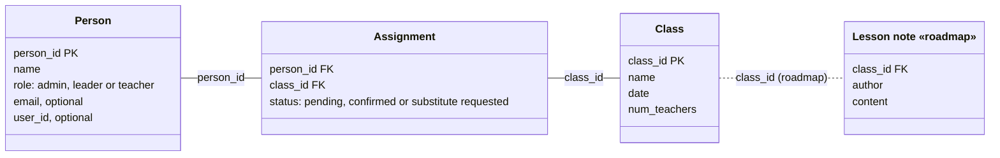

# Sunday School Scheduler — Design Document

| | |
|---|---|
| **Authors** | Hyrum Kammerman |
| **Reviewers** | [who reviewed it — a teammate, the instructor, a design-review partner] |
| **Status** | Draft |
| **Last updated** | 2026-10-20 |
| **Links** | [Proposal](https://docs.google.com/document/d/19jYz_kN3rfb-afqCQExlSvgMchcfi33fQDmuWVzpjow/edit?usp=sharing) · [Repository](https://github.com/Sunday-School-Software/Sunday-School-Scheduler) · [Issue tracker](https://github.com/Sunday-School-Software/Sunday-School-Scheduler/issues) |

## Revision history

Details for each revision are in the commit messages (`git log docs/design.md`).

| Date | Author | What changed |
|---|---|---|
| 2026-10-16 | Hyrum Kammerman | First draft |
| 2026-10-20 | Hyrum Kammerman | Revised after draft review; Mermaid diagrams |
| 2026-10-20 | Hyrum Kammerman | Moved the services to a Node backend on EC2; trimmed to length |

---

## 1. Context and scope

Sunday School Scheduler is a web app that helps a Sunday School presidency in The Church of Jesus Christ of Latter-day Saints make sure every class on every Sunday has a teacher. Today my ward schedules teachers in a spreadsheet and confirms them by copying and pasting individual messages, which takes real effort and leads to last-minute substitutions. The app shows the presidency which lessons are covered, gives teachers a one-click way to confirm or ask for a substitute, and emails people when assignments are made or answered.

## 2. Goals and non-goals

**Goals**

- A presidency member never has to copy and paste messages to teachers: assigning or reassigning a teacher emails that teacher automatically within 5 minutes.
- A teacher can see their assignments within the next 4 Sundays and confirm a lesson or request a substitute in under 1 minute.
- When a teacher requests a change, the presidency is notified within 5 minutes.
- A presidency member can see who is assigned to every class for the next 4 Sundays in under 1 minute, and spot the uncovered classes at a glance.
- Running cost stays near zero, within free tiers wherever possible.

**Non-goals**

- Other organizations (Relief Society, Elders' Quorum, Primary). The data model is Sunday School–specific.
- More than one ward. There is no multi-tenant separation in the MVP.
- Lesson-plan and content sharing between teachers.
- SMS notifications. Email only for the MVP (see §6).
- Importing members from Member Tools or other Church systems. People sign up, and leader roles are added by hand until admin functionality is implemented.

## 3. System-context diagram

## 4. Architecture and components

The UI runs in the browser. Everything else is one Node (TypeScript) process on an EC2 instance: an API that every request passes through, and four services behind it. The browser never holds AWS credentials; only the instance's IAM role can call DynamoDB and SES.

| Component | Responsibility | Talks to | Interface (rough) |
|---|---|---|---|
| UI | Sign-in, the teacher dashboard, the leader schedule, confirm/substitute actions, and success, warning and error messages. Holds the session JWT. | API | HTTPS JSON with the JWT, e.g. `POST /login`, `GET /assignments`, `PUT /assignments/{class}` |
| API | The server's only entry point. Verifies the caller, checks their role, calls the services, and sends notifications after a successful write. | UI and the four services | HTTP routes returning JSON and status codes (200, 403, 503) |
| Auth Service | Signs users up and in through Cognito and verifies JWTs | Cognito | `register()`, `login()`, `logout()` → JWT; `verify(jwt)` → user_id |
| User Service | Creates people, links a new account to its Person, finds the caller, lists the leaders | DB | `create(name, email?)`, `linkAccount(user_id, email)`, `findByUser(user_id)` → Person, `listLeaders()` → emails |
| Class Service | Classes, assignments and responses, using conditional writes so concurrent edits can't overwrite each other | DB | `createClass()`, `assign(class, person)`, `reassign(class, from, to)`, `listAssignments(person, dates)`, `listSchedule(dates)`, `update(class, person, status)` |
| Email Service | Sends notification emails. Only the API calls it. | SES | `email(addresses, message)` → OK/error |

**Who can do what.** A teacher sees and responds to only their own assignments; anything else returns 403. A leader can also create classes and people, assign and reassign teachers, record responses for anyone, and see the full schedule. An admin manages accounts and roles (stretch milestone 6).

### Hosting

One EC2 instance, in the same AWS account as Cognito, DynamoDB and SES, runs Caddy in front of the Node process. Caddy serves the built UI bundle, provides HTTPS on the app's domain with automatic certificates, and forwards `/api` requests to Node. The instance's IAM role grants access to the app's tables and to SES, so no AWS keys live in the code. The instance holds no data, so it can be rebuilt from the repository; the setup steps belong to CP7.

### Core flow, traced end to end

**A teacher confirms an assigned lesson.**

1. The teacher signs in. UI → API `POST /login` → Auth Service `login()` → Cognito. The UI keeps the returned JWT. (The sequence diagram starts after this step.)
2. UI → API `GET /assignments`. The API identifies the caller with `verify(jwt)` → user_id and `findByUser(user_id)` → Person and role.
3. API → Class Service `listAssignments(person, next 4 Sundays)`. The UI renders the dashboard.
4. The teacher clicks **Confirm**. UI → API `PUT /assignments/{class}`. The API identifies the caller again and checks that the assignment is theirs (or that they're a leader).
5. API → Class Service `update(class, person, status)`, a conditional write that returns OK.
6. API → User Service `listLeaders()`, then Email Service `email(addresses, message)` through SES.
7. The API returns success and the UI shows a success message.

A substitute request is the same flow with a different `status`.

### The failure case

**The database is down when the teacher clicks Confirm.** The conditional write fails, Class Service returns an error, and the API returns 503 without calling the Email Service. The UI says "Couldn't save your response, please try again." Nothing changed and nobody was emailed, and saving the same status again is safe, so recovery is simply retrying.

**The write succeeds but the email fails.** SES returns an error, so the API returns success with a "not notified" flag. The UI warns: "Your response was saved, but we couldn't notify the presidency. Please let them know directly." The saved status already shows on the leader's schedule. The app doesn't retry (see §7).

## 5. Data model

| Entity | Key fields | Relationships | Owned by | MVP or roadmap |
|---|---|---|---|---|
| Person | person_id, name, role (admin / leader / teacher), email (optional), user_id (optional) | Has many Assignments; may link to one Cognito account | User Service | MVP |
| Class | class_id, name, date, num_teachers | One meeting of a class on one Sunday; has many Assignments | Class Service | MVP |
| Assignment | person_id, class_id, status (pending / confirmed / substitute requested) | Joins Person and Class | Class Service | MVP |
| Lesson note | class_id, author, content | Belongs to one Class | Class Service | Roadmap |

Cognito owns credentials and login emails. Person covers teachers and leaders, so presidency emails go to people whose role is leader, and a leader can still be assigned to teach. A Person can have no account and no email: leaders still assign them and record their responses after talking to them. When someone signs up, `linkAccount()` attaches the account to the Person with the same email, or creates a new teacher.

A Class is one meeting on one date, so Gospel Doctrine on Nov 8 and on Nov 15 are two Class records. When a leader replaces a teacher, `reassign()` swaps the Assignment for a pending one in a single write, and the API emails both teachers (except anyone with no email).

On the schedule, a class is **covered** when it has `num_teachers` assignments that are all confirmed, **tentative** when it has `num_teachers` assignments and at least one is pending, and **uncovered** otherwise (too few assignments, or a substitute requested).

## 6. Technology choices and alternatives considered

### Decision: put a Node backend between the UI and AWS

- **Chosen:** A Node (TypeScript) API on one EC2 instance behind Caddy. Only the API calls DynamoDB and SES.
- **Alternative considered:** No backend. The browser gets temporary AWS credentials from a Cognito identity pool and calls DynamoDB and SES directly, limited by fine-grained IAM policies.
- **Why the chosen option wins, given our goals:** Our rules are about roles and fields (a teacher may change only the status of their own assignment; a leader may change any), which are awkward to express and test as IAM conditions. IAM also can't limit SES to notification emails, so any signed-in user could send any email from our address. A backend keeps every rule in testable code, and it's what the proposal planned. The cost is a server to run, patch and pay for, and a single point of failure (§7).
- **Evidence:** CP3 spike (`aws-spike`): an Express/TypeScript app deployed to EC2 sent email through SES.
- **What would change our mind:** The instance's cost or upkeep becomes a problem. The same routes could move to Lambda behind API Gateway, keeping the checks on the server.

### Decision: send notifications by email through AWS SES

- **Chosen:** Email through SES.
- **Alternative considered:** SMS through AWS SNS, which teachers would read fastest on a Sunday morning.
- **Why the chosen option wins, given our goals:** The 5-minute notification goals need a channel that works this semester. SMS needs registration steps we can't count on finishing in time. SES shares the stack's AWS account and is effectively free at our volume.
- **Evidence:** CP3 spike (`aws-spike`): SES delivered; SNS SMS did not.
- **What would change our mind:** Teachers say they don't check email fast enough to meet the 5-minute goal. SMS would then become a roadmap item.

### Decision: store data in DynamoDB

- **Chosen:** Amazon DynamoDB.
- **Alternative considered:** PostgreSQL on the EC2 instance.
- **Why the chosen option wins, given our goals:** DynamoDB has no database to back up or upgrade, it keeps the EC2 instance stateless and rebuildable, and our volume (a few dozen people, a few hundred assignments a year) fits the free tier. PostgreSQL would tie the data to one machine and put backups on a solo developer. The cost is that our model is relational: instead of SQL joins, we design keys around our access patterns ("a teacher's assignments", "the next 4 Sundays") and enforce relationships in the services.
- **Evidence:** None yet for DynamoDB; the spike confirmed AWS access from this account.
- **What would change our mind:** The access patterns need joins or ad-hoc queries that don't fit the key design, or roadmap features make the model much more relational.

### Decision: use Amazon Cognito for sign-in

- **Chosen:** A Cognito user pool for sign-up, sign-in and account recovery. The API verifies its JWTs.
- **Alternative considered:** Our own auth: hashed passwords in DynamoDB and our own session tokens.
- **Why the chosen option wins, given our goals:** The app stores ward members' contact details, so auth mistakes are the costliest kind, and a solo developer with 20–25 hours can't carefully build password storage, token expiry and reset flows. Cognito provides them within the free tier. The cost is lock-in to its flows and harder-to-debug configuration.
- **Evidence:** None yet. The proposal budgets about 4 hours for database and Cognito setup.
- **What would change our mind:** Setup runs well past that budget in milestone 1, or the verification step loses teachers who aren't comfortable with technology.

## 7. Risks and open questions

| Risk or question | Why it matters | Owner | How we'll find out, and by when |
|---|---|---|---|
| The single EC2 instance goes down during the pilot. | Nobody can sign in or respond on a Sunday morning. | Hyrum | Script the setup in CP7 so it can be rebuilt; deploy in milestone 1 so it runs for three weeks before the pilot. |
| The write succeeds but the email fails, and we only warn (§4). | If the teacher ignores the warning, the presidency never hears. | Hyrum | Force an SES error in milestone 2. If the pilot shows missed notifications, add a retry. |
| SES sandbox only sends to verified addresses. | Real teachers get no email until AWS grants production access. | Hyrum | Request production access in milestone 2; needed before the pilot. |
| Two people edit the same class at once. | A lost update could show a class as covered when it isn't. | Hyrum | Conditional writes; test with two browsers in milestone 4. |
| DynamoDB keys for relational data. | A poor key design makes the 4-Sunday view slow or awkward. | Hyrum | Write down the access patterns and prototype the tables in milestone 1. |
| Collecting contact information ethically. | Church member data has usage policies. | Hyrum | Check Member Tools policies and include only people who agree, before the pilot. |
| Will teachers use this rather than texts? | The value depends on teachers responding in the app. | Hyrum | Interview 1–2 other teachers before milestone 3. |

## 8. Implementation plan

The build window is Weeks 9–13 (Oct 26 – Nov 29), about 20–25 hours. Milestones 1–4 are the proposal's P0 deliverable; 1–5 come to about 22 hours. Milestone 6 is a P1 stretch goal.

| Milestone | What works when it's done | Depends on |
|---|---|---|
| 1 · Nov 8 · ~7 h | **Thinnest slice, deployed:** the app runs on EC2 behind Caddy. A teacher logs in, sees their hand-seeded assignments and confirms one; the API rejects changes to others' assignments; the UI shows success or the DB-down error. | — |
| 2 · Nov 15 · ~3 h | **Notifications:** confirming or requesting a substitute emails the presidency, with the email-failed warning. SES production access requested. | 1 |
| 3 · Nov 18 · ~6 h | **Leader schedule:** a leader creates classes, assigns and reassigns teachers (emailing them), and sees the next 4 Sundays marked covered, tentative or uncovered. | 1, 2 |
| 4 · Nov 22 · ~4 h | **Teachers outside the app, safe concurrent edits:** leaders add people without accounts or email and record their responses; sign-up links to an existing Person; simultaneous edits can't overwrite each other. | 3 |
| 5 · Nov 29 and Dec 6 · ~2 h | **Ward pilot:** SES production access approved; the ward uses the app for two Sundays (the proposal's success criterion). | 4 |
| 6 · stretch · ~3–4 h | **Admin and broadcast:** an admin creates accounts and sets roles; a leader messages all teachers at once. | 2, 3 |

---

## Sign-off

| Reviewer | Role | Date | Approved |
|---|---|---|---|
| [name] | [role] | [date] | ☐ |
